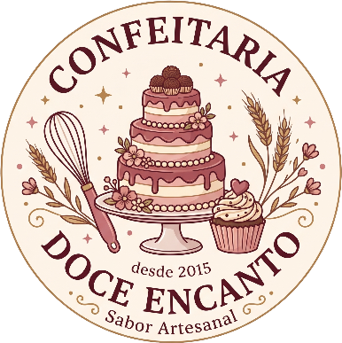
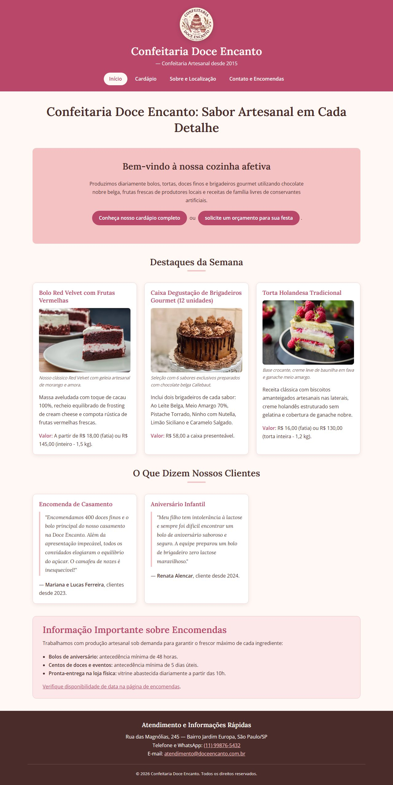
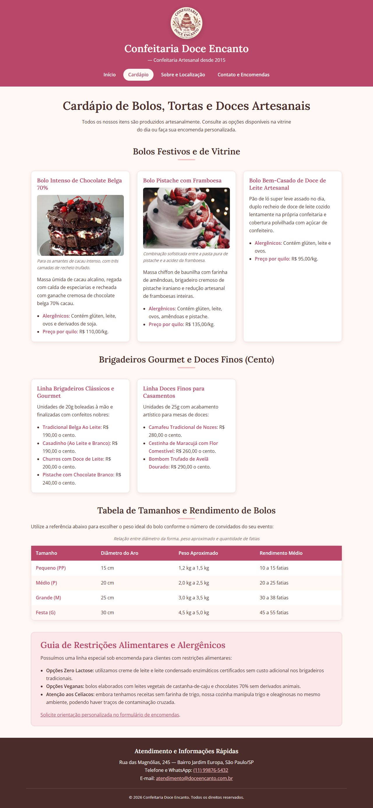
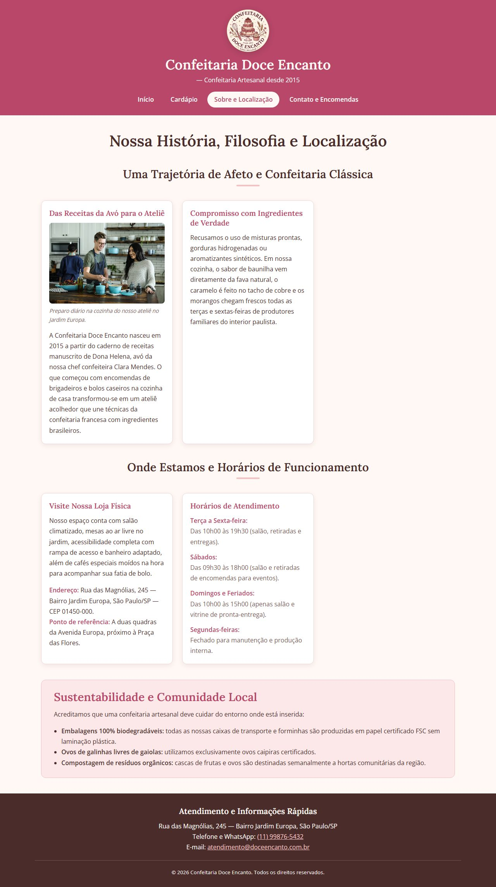
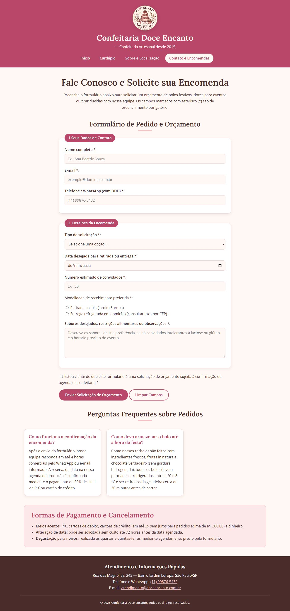
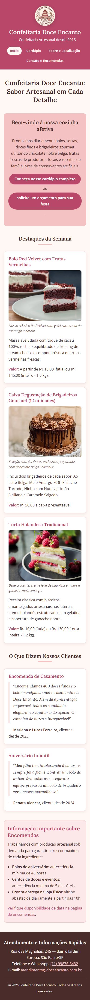
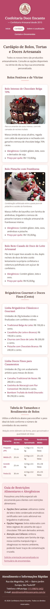
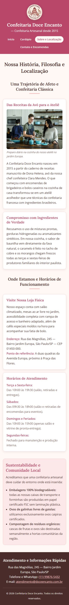
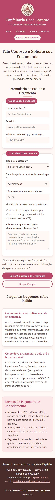

<div align="center">



# Confeitaria Doce Encanto

**Site institucional, cardápio e canal de encomendas de uma confeitaria artesanal em São Paulo.**


</div>

---

## Sobre o projeto

A **Doce Encanto** é uma confeitaria artesanal fictícia, no bairro Jardim Europa, em São Paulo/SP, em atividade desde 2015. O site apresenta a loja, mostra o cardápio com preços e tamanhos de bolos e recebe pedidos de orçamento por um formulário.

Ele é feito só com **HTML5 e CSS3**, sem frameworks e sem JavaScript, e funciona abrindo o arquivo direto no navegador.

## Páginas

| Página | Arquivo | O que oferece |
| --- | --- | --- |
| **Início** | `index.html` | Boas-vindas, destaques da semana, depoimentos de clientes e avisos sobre prazos de encomenda |
| **Cardápio** | `cardapio.html` | Bolos, brigadeiros e doces finos com preços, tabela de tamanhos e rendimento, e guia de restrições alimentares |
| **Sobre e Localização** | `sobre.html` | História da confeitaria, endereço, horários de atendimento e práticas de sustentabilidade |
| **Contato e Encomendas** | `contato.html` | Formulário de orçamento com validação, perguntas frequentes e formas de pagamento |

## Visual do site

### Versão desktop

<table>
  <tr>
    <td align="center" width="50%"><b>Início</b><br></td>
    <td align="center" width="50%"><b>Cardápio</b><br></td>
  </tr>
  <tr>
    <td align="center" width="50%"><b>Sobre e Localização</b><br></td>
    <td align="center" width="50%"><b>Contato e Encomendas</b><br></td>
  </tr>
</table>

### Versão celular

<table>
  <tr>
    <td align="center"><b>Início</b><br></td>
    <td align="center"><b>Cardápio</b><br></td>
    <td align="center"><b>Sobre</b><br></td>
    <td align="center"><b>Contato</b><br></td>
  </tr>
</table>

## Design

**Layout clássico centralizado:** logo, nome da loja e menu ao centro, banner largo na página inicial e cards organizados em grade.

| Elemento | Escolha |
| --- | --- |
| Paleta | Morango e creme |
| Títulos | Lora (serifada) |
| Texto | Open Sans |
| Componentes | Botões em pílula, cards com cantos de 12px e sombra leve |

| Cor | Código | Uso |
| --- | --- | --- |
| Rosa framboesa | `#B8476A` | Cabeçalho, botões, links |
| Rosa claro | `#F4C2C2` | Banner e detalhes |
| Rosa suave | `#FCE8E8` | Caixas de aviso |
| Creme | `#FFF8F5` | Fundo da página |
| Marrom | `#4A2C2A` | Texto e rodapé |

Todas as cores, raios e sombras são variáveis CSS em `:root`. Para mudar a identidade visual, basta editar esses valores no início de `css/style.css`.

## Responsividade

O layout se adapta de **390px (celular)** a **1280px (desktop)**:

- **CSS Grid:** os cards se distribuem em colunas automáticas, de 3 por linha no desktop até 1 no celular.
- **Flexbox:** o menu de navegação quebra de linha conforme a largura disponível.
- **Media query (600px):** menu, banner, tabela e avisos mais compactos, e botões em largura total.
- **Tipografia fluida:** títulos com `clamp()` que se ajustam ao tamanho da tela.
- **Imagens fluidas:** ocupam a largura do card e mantêm a proporção.

## Acessibilidade

- Estrutura semântica com `header`, `nav`, `main`, `section`, `article`, `aside` e `footer`.
- Link "Pular para o conteúdo principal", que aparece ao navegar pelo teclado.
- Contorno de foco visível em links, botões e campos.
- Página atual indicada com `aria-current="page"` no menu.
- Textos alternativos em todas as imagens.
- Formulário com `label`, `fieldset`, `legend` e validação nativa do navegador.
- Contraste de cores dentro do nível AA da WCAG.

## Estrutura do repositório

```text
├── index.html          # Início
├── cardapio.html       # Cardápio
├── sobre.html          # Sobre e Localização
├── contato.html        # Contato e Encomendas
├── css/
│   └── style.css       # Folha de estilos única, em 15 blocos numerados
├── img/
│   ├── logo-doce-encanto.png
│   └── prints/         # Capturas de tela usadas neste README
└── README.md
```

## Como visualizar

```bash
git clone https://github.com/xcamomilla/ProjetoIntegradorHTML.git
cd ProjetoIntegradorHTML
```

Abra o `index.html` em qualquer navegador moderno (Chrome, Edge, Safari ou Firefox). Não é preciso instalar nada.

> As fotos dos produtos são carregadas da internet e as fontes vêm do Google Fonts, então é preciso estar conectado para ver tudo como nas capturas.

---

<div align="center">

© 2026 Confeitaria Doce Encanto · Rua das Magnólias, 245 — Jardim Europa, São Paulo/SP

</div>
